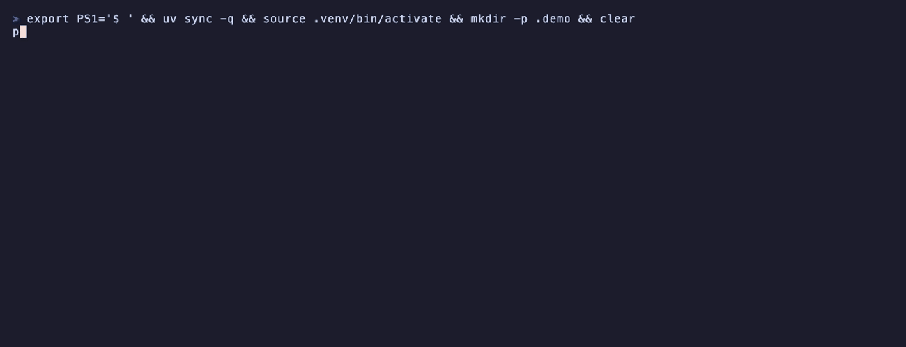
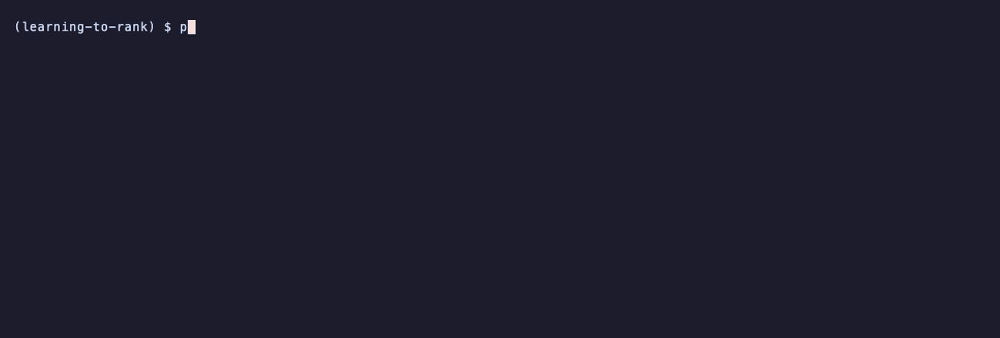
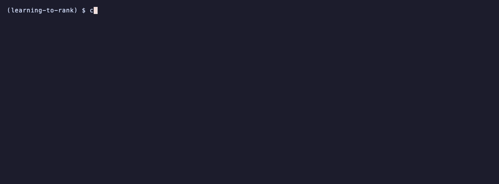

<h1 align="center">LambdaMART Ranking Engine</h1>

<p align="center">
  <em>A from-scratch library, with a Rust core, that learns how to order search results, measured against LightGBM and XGBoost on two public datasets.</em>
</p>

<p align="center">
  <a href="https://github.com/adeoluo/lambdamart-ranking-engine/actions/workflows/ci.yml"></a>
  <a href="https://github.com/adeoluo/lambdamart-ranking-engine/releases"></a>
  
  
  <a href="LICENSE"></a>
</p>

---

> **Evidence level: publicly benchmarked.** The project is compared with LightGBM and XGBoost on all five folds of MSLR-WEB10K and on Istella-S, and the results for each fold are committed. Nobody else has reproduced the results, and the project is not used in production. [What the levels mean](https://github.com/adeoluo#evidence-levels).

## Highlights

Ranking decides which results a person sees first in a search engine or a feed. This project is
a ranking engine built from scratch. It is tested against LightGBM and XGBoost, two widely
used libraries for this task, on the same public data.

- **It ties LightGBM on Microsoft's search dataset, MSLR-WEB10K.** Its NDCG@10 (quality of the
  top 10 results, 0 to 1, higher is better) is 0.5029, compared with 0.5042 for LightGBM. The
  gap is too small to count as a real difference (p = 0.10).
- **It has the highest score on a second dataset, Istella-S.** It scores 0.7603 NDCG@10,
  compared with 0.7595 for LightGBM, a statistical tie. XGBoost scores 0.7554, which is
  significantly lower.
- **It learns well from simulated clicks.** Inverse propensity weighting (IPW) corrects for
  users clicking top results more often. With mild position bias, it recovers 0.021 of the
  0.025 NDCG@10 gap between training on raw click rates and training on the true labels of
  the shown documents.
- **Every result is published with its raw data.** The scores for each fold are committed with
  the statistical tests, and one script prints every results table again from them.

**Where it falls short:** LightGBM trains about twice as fast (1.7 to 2.4 times faster).
XGBoost scores slightly higher on MSLR-WEB10K (0.5061 compared with 0.5029). The clicks come
from simulated users, not real ones.

## Key terms

Plain definitions of the terms used in this README.

| Term | Meaning |
|---|---|
| Cascade model | A click model in which a user reads results from the top, clicks the first attractive one, and then stops. |
| Confidence interval (95% CI) | A range that contains the true mean difference between two systems with 95% confidence. If the range excludes 0, the difference is significant. |
| ERR@10 (expected reciprocal rank) | Models a user who reads the top 10 results and stops at the first satisfying one. From 0 to 1, higher is better. |
| Expectation maximization (EM) | A standard method that estimates hidden quantities from data. Here it estimates, from clicks alone, how likely each rank is to be seen. |
| Fold | One of five fixed splits of MSLR-WEB10K into training, validation and test queries. Each query is a test query in exactly one fold. |
| Holm adjustment | A correction of p-values when several comparisons are tested together, so that chance results are less likely to look significant. |
| Inverse propensity weighting (IPW) | Each click gets a weight of 1 divided by the probability that its rank was seen. Clicks further down the list count more, which corrects for position bias. |
| Istella-S | A public dataset from the Italian web search engine Istella: 33,018 queries, 3,408,630 judged documents and 220 numeric features per document. |
| LambdaMART | Gradient-boosted decision trees (many small trees added one at a time, each correcting the previous ones) trained with LambdaRank. The standard tree method for ranking. |
| LambdaRank | A training signal for ranking. It pushes each pair of documents apart in proportion to how much swapping them would change NDCG. |
| LightGBM | Microsoft's open-source gradient-boosting library. `lambdarank` is its ranking objective. It is the main comparison point here. |
| MAP (mean average precision) | Average precision rewards placing all relevant documents of a query high. MAP is its mean over all queries. From 0 to 1, higher is better. |
| MLP (multilayer perceptron) | A plain feed-forward neural network. Here it gives each document a score from its numeric features. |
| MRR (mean reciprocal rank) | 1 divided by the rank of the first relevant document, averaged over queries. From 0 to 1, higher is better. |
| MSLR-WEB10K | Microsoft's public learning-to-rank dataset: 10,000 web queries, 1,200,192 documents judged on a 0 to 4 relevance scale, and 136 numeric features. |
| NDCG@k | Normalized discounted cumulative gain at k: how close the top k results are to the ideal order, weighting top ranks more. From 0 to 1, higher is better. |
| p-value | The probability of a difference at least this large if the two systems were really equal. Below 0.05 counts as significant here. |
| Perplexity | How well a click model predicts clicks it has not seen. 1 is perfect, lower is better. |
| Pointwise, pairwise and listwise loss | Three ways to train a ranker: score each document alone, compare pairs of documents (RankNet), or compare whole result lists (ListNet). |
| Position-based model (PBM) | A click model in which each rank is seen with a fixed probability, and a seen result is clicked if it is attractive. |
| Propensity | The probability that a user sees a given rank. Results further down the list are seen less often, so they get fewer clicks. This effect is called position bias. |
| Randomization test | A significance test. It flips the sign of each per-query difference at random 10,000 times and counts how often the result is as large as the real one. |
| t-test | A paired Student's t-test on the per-query differences between two systems. It gives a p-value and the 95% confidence interval. |
| Unbiased learning to rank | Training a ranker from click logs while correcting for biases in the clicks, such as position bias. |
| XGBoost | A widely used open-source gradient-boosting library. `rank:ndcg` is its ranking objective. |

## Motivation

Ranking quality decides what the users of a search engine or an ads system see first. Offline
evaluation, which scores rankers on stored judged data, decides which ranker is released. Both
need more than one headline number. The learner has to compete with the libraries that teams
actually use. The comparison has to use identical data and a significance test. The error
analysis has to show which queries got better or worse.

This project implements the standard learning-to-rank toolkit and measures every part of it:

- LambdaMART on histogram trees, with the most time-critical loops written in Rust (a fast
  compiled programming language). A histogram tree first groups the values of each feature into
  at most 255 buckets (bins). It then sums the gradients per bin, so the search for the best
  split is fast.
- MLP rankers trained with pointwise, pairwise and listwise losses.
- Ranking metrics, tested against other libraries and against direct reference code.
- Click models, and training from simulated clicks with inverse propensity weighting.
- Paired significance tests, which compare two rankers query by query on the same queries.
- Segment analysis by query popularity and query length.

The tree learner is compared with LightGBM `lambdarank` and XGBoost `rank:ndcg`. The comparison
uses the five MSLR-WEB10K folds (1,200,192 judged query-document pairs) and Istella-S (3,408,630
pairs).

## Architecture

<p align="center">
  
</p>

<sub>Legend: amber = entry points and external systems, indigo = core logic, green = data and state, blue = validation and control, grey = observability and outputs.</sub>

Requests enter through the command-line interface (CLI) or the HTTP service, which checks the
shape and size of every input. Loaders turn MSLR-WEB10K and Istella-S into dense float32
matrices (32-bit decimal numbers), or into `uint8` matrices (8-bit whole numbers) with 255 bins
per feature. The click simulator writes session
logs. Training runs in the learning layer, which has three parts:

- LambdaRank gradients and leaf-wise histogram trees in Rust. Leaf-wise means the tree always
  splits the leaf that gains most. A reference implementation in numpy (Python's array library)
  produces the same trees.
- PBM and cascade click models, which produce IPW training targets.
- MLP rankers in PyTorch (a neural network library).

Every score goes through the same vectorized metric code, then through paired tests and segment
reports. The service exports Prometheus counters (request statistics in a standard monitoring
format). Module-level detail is in [docs/ARCHITECTURE.md](docs/ARCHITECTURE.md).

## Results

All numbers below come from the scripts in [benchmarks/](benchmarks/). The raw JSON results,
including NDCG@10 for every query and a description of the machine, are in
[benchmarks/results/](benchmarks/results/). The command
`uv run python benchmarks/report.py` prints every table in this section (uv is a Python package
manager). All runs used one Apple M1 laptop (8 cores, 8 GB memory). Other jobs shared the
machine during the runs. Each result records 1-minute load averages (the average number of
processes running or waiting to run) of 5 to 16. So wall-clock times are only indicative, and
they are comparable only within one table.

### LambdaMART against LightGBM and XGBoost, MSLR-WEB10K

MSLR-WEB10K has 10,000 queries, 1,200,192 judged documents and 136 features, in five folds. In
each fold three partitions are used for training, one for validation and one for testing. Every
library uses identical settings: 500 trees, learning rate 0.1, 31 leaves grown leaf-wise, at most
255 bins, at least 20 documents per leaf, 8 threads, no early stopping, and random seed 0. The
test metrics of all three libraries are computed by the same code, `learning_to_rank.metrics`.
NDCG uses the gain `2^rel - 1`, so the gain grows exponentially with the relevance grade. A query
without relevant documents scores 1, as in LightGBM and XGBoost. This choice is recorded in the
architecture decision record
[ADR-0003](docs/adr/0003-lightgbm-lambdarank-definition-and-metric-conventions.md).

The first table shows the mean ± standard deviation over the five folds. Each row is a library
and each column is a test metric. For the metrics, higher is better. The last two columns are
training time in seconds and peak memory use in MB (peak RSS, resident set size). For these,
lower is better.

| Model | NDCG@1 | NDCG@3 | NDCG@5 | NDCG@10 | MAP | MRR | ERR@10 | Train s (500 trees) | Peak RSS MB |
|---|---:|---:|---:|---:|---:|---:|---:|---:|---:|
| LambdaMART, this package (Rust core) | 0.4872 ± 0.0080 | 0.4784 ± 0.0076 | 0.4849 ± 0.0077 | 0.5029 ± 0.0061 | 0.6133 ± 0.0036 | 0.8332 ± 0.0064 | 0.3600 ± 0.0067 | 68.1 ± 6.6 | 980 |
| LightGBM lambdarank | 0.4913 ± 0.0083 | 0.4808 ± 0.0073 | 0.4868 ± 0.0065 | 0.5042 ± 0.0056 | 0.6135 ± 0.0040 | 0.8357 ± 0.0064 | 0.3618 ± 0.0060 | 39.7 ± 2.9 | 1,159 |
| XGBoost rank:ndcg | 0.4942 ± 0.0090 | 0.4834 ± 0.0073 | 0.4892 ± 0.0071 | 0.5061 ± 0.0048 | 0.6147 ± 0.0034 | 0.8359 ± 0.0043 | 0.3639 ± 0.0068 | 81.5 ± 6.6 | 963 |

The next table shows each fold separately. Each row is a fold. The middle columns give test
NDCG@10 for each library (higher is better), and the last column gives training seconds (lower
is better).

| Fold | Train docs | Test queries | This package | LightGBM | XGBoost | Fit s: ours / LightGBM / XGBoost |
|---|---:|---:|---:|---:|---:|---|
| 1 | 723,412 | 2,000 | 0.5044 | 0.5038 | 0.5072 | 78 / 43 / 88 |
| 2 | 716,683 | 2,000 | 0.5001 | 0.5024 | 0.5054 | 70 / 42 / 86 |
| 3 | 719,111 | 2,000 | 0.4937 | 0.4961 | 0.4983 | 67 / 40 / 84 |
| 4 | 718,768 | 2,000 | 0.5082 | 0.5093 | 0.5101 | 67 / 39 / 76 |
| 5 | 722,602 | 2,000 | 0.5081 | 0.5095 | 0.5097 | 59 / 35 / 73 |

The paired tests below use all 10,000 queries, because each query is a test query in exactly one
fold. Each row compares one system with LightGBM on NDCG@10. The columns give the mean
difference with its 95% confidence interval from the t-test, the p-value of a two-sided t-test,
and the p-value of a randomization test with 10,000 sign flips. A positive difference means better than LightGBM. A
p-value below 0.05 means the difference is significant. The last column counts the queries
where the system scores higher than, equal to, or lower than LightGBM.

| System vs LightGBM | Mean NDCG@10 | Difference | 95% CI | t-test p | Randomization p | Wins / ties / losses |
|---|---:|---:|---|---:|---:|---|
| LambdaMART (this package) | 0.5029 | -0.0013 | [-0.0028, +0.0003] | 0.103 | 0.107 | 4,515 / 778 / 4,707 |
| XGBoost | 0.5061 | +0.0019 | [+0.0005, +0.0034] | 0.00932 | 0.0097 | 4,677 / 827 / 4,496 |
| MLP, ListNet | 0.4907 | -0.0135 | [-0.0157, -0.0113] | 1.15e-32 | 0.0001 | 4,170 / 582 / 5,248 |
| MLP, RankNet | 0.4841 | -0.0201 | [-0.0224, -0.0177] | 5.61e-61 | 0.0001 | 4,112 / 573 / 5,315 |

Reading: this package's LambdaMART is 0.0013 NDCG@10 below LightGBM, and the difference is not
significant (p = 0.10). XGBoost is 0.0019 above LightGBM, and this difference is significant
(p = 0.01). LightGBM trains 1.7 times faster than this package, and XGBoost is the slowest of the
three. Peak memory use is similar.

### Istella-S

Istella-S has 33,018 queries and 3,408,630 judged documents with 220 features. Istella split it
into training (19,245 queries, 2,043,304 documents), validation (7,211 queries) and test (6,562
queries, 681,250 documents) sets. Stored as float32, the training matrix alone takes 1.8 GB. So
the archive is converted once into `uint8` matrices with 255 bins per feature, and all three
libraries train on the same bin indices
([ADR-0005](docs/adr/0005-istella-as-shared-binned-matrices.md)). The settings are the same as on
MSLR-WEB10K, with one run per library on the official split. Training time includes the time
LightGBM and XGBoost need to build their own datasets from the bins (11 s and 15 s).

The table has the same layout as the first MSLR-WEB10K table, with one row per library. For the
test metrics higher is better. For training seconds and peak memory in MB lower is better.

| Model | NDCG@1 | NDCG@5 | NDCG@10 | MAP | MRR | ERR@10 | Train s (500 trees) | Peak RSS MB |
|---|---:|---:|---:|---:|---:|---:|---:|---:|
| LambdaMART, this package (Rust core) | 0.7100 | 0.6992 | 0.7603 | 0.8714 | 0.9694 | 0.7516 | 496 | 1,040 |
| LightGBM lambdarank | 0.7039 | 0.6976 | 0.7595 | 0.8714 | 0.9688 | 0.7485 | 203 | 1,152 |
| XGBoost rank:ndcg | 0.7042 | 0.6935 | 0.7554 | 0.8662 | 0.9687 | 0.7480 | 391 | 1,595 |

The paired tests below compare test NDCG@10 over the 6,562 test queries. Each row compares one
system with LightGBM. A positive difference means better than LightGBM, and a p-value below 0.05
means the difference is significant.

| System vs LightGBM | Difference | 95% CI | t-test p | Randomization p |
|---|---:|---|---:|---:|
| LambdaMART (this package) | +0.0008 | [-0.0004, +0.0020] | 0.197 | 0.204 |
| XGBoost | -0.0040 | [-0.0053, -0.0027] | 9.4e-10 | 0.0001 |

On Istella-S this package's LambdaMART and LightGBM are level (+0.0008, p = 0.20), and XGBoost
is significantly lower. LightGBM trains 2.4 times faster than this package here.

### Neural rankers

All four neural rankers use the same MLP: layer sizes 136, 256, 256, 128 and 1, with ReLU
activations and dropout 0.1. Training uses the Adam optimizer at learning rate 1e-3 for up to 30
epochs. It stops early when validation NDCG@10 has not improved for 5 epochs. The seed is 0, and
training runs in PyTorch on Apple MPS (the Mac graphics processor).

The table shows the mean ± standard deviation over the five MSLR-WEB10K folds. Each row is one
training loss. For the metrics, higher is better. For training seconds, lower is better.

| Model | NDCG@1 | NDCG@3 | NDCG@5 | NDCG@10 | MAP | MRR | ERR@10 | Train s |
|---|---:|---:|---:|---:|---:|---:|---:|---:|
| MLP, pointwise | 0.4669 ± 0.0069 | 0.4595 ± 0.0066 | 0.4672 ± 0.0049 | 0.4867 ± 0.0039 | 0.6143 ± 0.0034 | 0.8308 ± 0.0036 | 0.3460 ± 0.0035 | 187 ± 117 |
| MLP, ranknet | 0.4538 ± 0.0093 | 0.4546 ± 0.0073 | 0.4631 ± 0.0068 | 0.4841 ± 0.0067 | 0.6190 ± 0.0040 | 0.8395 ± 0.0068 | 0.3357 ± 0.0078 | 232 ± 204 |
| MLP, lambdarank | 0.4811 ± 0.0112 | 0.4638 ± 0.0082 | 0.4682 ± 0.0061 | 0.4861 ± 0.0048 | 0.6083 ± 0.0026 | 0.8310 ± 0.0070 | 0.3498 ± 0.0076 | 273 ± 227 |
| MLP, listnet | 0.4728 ± 0.0084 | 0.4628 ± 0.0072 | 0.4692 ± 0.0062 | 0.4907 ± 0.0059 | 0.6065 ± 0.0038 | 0.8165 ± 0.0052 | 0.3536 ± 0.0058 | 349 ± 228 |

ListNet is the best of the four losses at NDCG@10. Every MLP is below the tree ensembles, by
0.013 to 0.020 NDCG@10, and all these differences are significant. RankNet has the best MAP and
MRR of any model in this README. These two metrics reward placing any relevant document high,
rather than getting the order of the relevance grades right. The large spread in training time
comes from the shared graphics processor, not from the losses.

### Segment analysis

MSLR-WEB10K has no query frequencies. So a query's popularity is measured by the total logged
clicks on its documents (feature 134). Head is the 10 percent most popular queries, torso the
next 40 percent, and tail the remaining 50 percent. Query length is recovered from two features:
the number of query terms a document covers, and the share of query terms it covers. "Unknown"
means the length could not be recovered.

The tables show mean NDCG@10 over all 10,000 queries. Higher is better. Each row is a segment
(a group of queries), and each model column gives that model's score. A `*` marks a difference
from LightGBM that is significant at 0.05 in a randomization test, after Holm adjustment across
segments.

| Segment | Queries | LambdaMART (this package) | LightGBM | XGBoost | MLP, ListNet | MLP, RankNet |
|---|---:|---:|---:|---:|---:|---:|
| head | 1,000 | 0.5146 | 0.5133 | 0.5100 | 0.4972 * | 0.4653 * |
| torso | 4,000 | 0.5386 | 0.5397 | 0.5407 | 0.5231 * | 0.5128 * |
| tail | 5,000 | 0.4720 | 0.4740 | 0.4777 * | 0.4635 * | 0.4650 * |

| Query length (terms) | Queries | LambdaMART (this package) | LightGBM | XGBoost | MLP, ListNet | MLP, RankNet |
|---|---:|---:|---:|---:|---:|---:|
| 1 | 1,938 | 0.5379 | 0.5364 | 0.5367 | 0.5129 * | 0.4990 * |
| 2 | 3,723 | 0.5007 | 0.5025 | 0.5045 | 0.4870 * | 0.4804 * |
| 3 | 2,459 | 0.4948 | 0.4967 | 0.5000 | 0.4877 * | 0.4835 * |
| 4 | 1,087 | 0.4833 | 0.4862 | 0.4870 | 0.4778 * | 0.4769 * |
| 5+ | 610 | 0.5075 | 0.5092 | 0.5125 | 0.5167 | 0.5193 * |
| unknown | 183 | 0.3880 | 0.3893 | 0.3901 | 0.3617 * | 0.3380 * |

Tail queries are the hardest for every model, 0.05 to 0.07 below the torso. XGBoost's lead over
LightGBM is significant only in the tail, and on head queries XGBoost is behind. This package's
LambdaMART and LightGBM are within 0.003 of each other in every segment, with no significant
difference. The MLPs trail the trees in almost every segment, RankNet by 0.048 on head queries.
On queries of five or more terms, however, the MLPs are level with or ahead of the trees. This is
the one segment where RankNet beats LightGBM significantly.

### Unbiased learning to rank from simulated clicks

This section tests unbiased learning to rank: training a good ranker from biased clicks instead
of human relevance labels. The protocol is in
[ADR-0006](docs/adr/0006-click-simulation-and-ipw-targets.md):

- A weak "production" LambdaMART (30 trees, trained on 60 random training queries) ranks the
  6,000 training queries of fold 1.
- 2,000,000 simulated sessions each show the top 10 results. Clicks follow the position-based
  model: a result at a given rank is seen with probability `(1/rank)^eta`, so a larger eta means
  stronger position bias.
- Click noise is 0.1, so an irrelevant document is still attractive with probability 0.1.
- In 10 percent of sessions a swap intervention exchanges the top result with the result at a
  random rank. This lets the propensities be estimated from the clicks.
- A LambdaMART with squared-error loss (300 trees, learning rate 0.05) is trained on the 59,436
  shown documents, once with each training target. It is evaluated on the fold 1 test queries
  with the true labels.

The table shows the mean ± standard deviation over seeds 0, 1 and 2. Each row is a training
signal, and the columns give test NDCG@10 and ERR@10 at eta 1 and eta 2. Higher is better.
"Naive" uses the raw click-through rate as the target. "Skyline" is the best case: the true
labels of the same shown documents. The last row, trained on all labelled data, is shown for
reference.

| Training signal | NDCG@10, eta 1 | ERR@10, eta 1 | NDCG@10, eta 2 | ERR@10, eta 2 |
|---|---:|---:|---:|---:|
| Production ranker (30 trees, 60 queries) | 0.4089 ± 0.0038 | 0.2919 ± 0.0037 | 0.4089 ± 0.0038 | 0.2919 ± 0.0037 |
| Naive: click-through rate as target | 0.4432 ± 0.0085 | 0.3328 ± 0.0044 | 0.4181 ± 0.0061 | 0.3203 ± 0.0026 |
| IPW, true propensities | 0.4646 ± 0.0084 | 0.3455 ± 0.0064 | 0.4552 ± 0.0068 | 0.3403 ± 0.0055 |
| IPW, swap-intervention propensities | 0.4646 ± 0.0077 | 0.3464 ± 0.0051 | 0.4540 ± 0.0089 | 0.3409 ± 0.0039 |
| IPW, EM (PBM) propensities | 0.4655 ± 0.0071 | 0.3458 ± 0.0035 | 0.4506 ± 0.0090 | 0.3386 ± 0.0050 |
| Skyline: true labels of the shown documents | 0.4677 ± 0.0057 | 0.3472 ± 0.0036 | 0.4677 ± 0.0057 | 0.3472 ± 0.0036 |
| Supervised, all 723,412 labelled training documents (500 trees) | 0.5044 | 0.3586 | 0.5044 | 0.3586 |

IPW closes most of the gap between naive click training and the skyline, which uses the full
information. At eta 1 it recovers 0.021 of the 0.025 NDCG@10 gap. At eta 2, with stronger
position bias, it recovers 0.032 to 0.037 of 0.050. Propensities estimated from swap
interventions or by EM work as well as the true ones at eta 1. At eta 2, EM is 0.005 behind. For
seed 0 the estimated curves of how often each rank is seen match the truth to within 0.02 at
every rank (`propensities` in [ultr_mslr.json](benchmarks/results/ultr_mslr.json)).

The next table checks the click models themselves. Each model is fitted on 80 percent of
2,000,000 sessions and scored by perplexity on the other 20 percent. Lower is better. Each row
is the kind of user that was simulated, and each column is the click model that was fitted.
"CTR by rank" is a simple baseline that uses only the click-through rate (CTR) at each rank.

| Users simulated as | PBM (EM) | Cascade | CTR by rank |
|---|---:|---:|---:|
| pbm | 1.2136 | 1.4482 | 1.2488 |
| cascade | 1.2709 | 1.2096 | 1.3202 |

Each click model fits best on the clicks of its own kind of user. This is the sanity check that
the EM and cascade estimators are correct.

### Training speed

The table gives wall-clock seconds to train 50 trees on fold 1 (723,412 documents) for each
number of threads. Lower is better. Threads are set with `RAYON_NUM_THREADS` for this package
and with `num_threads` for LightGBM. Each run uses its own process. Each row is a library, and
each column is a thread count.

| Threads | 1 | 2 | 4 | 8 |
|---|---:|---:|---:|---:|
| This package, s | 95.1 | 46.8 | 27.5 | 26.5 |
| LightGBM, s | 48.6 | 24.4 | 20.8 | 23.5 |

With one thread, LightGBM is twice as fast. This package speeds up 3.5 times from 1 to 4
threads. Neither library gains from 8 threads here, because other jobs held 5 to 10 cores during
the run. The Rust core trains 5 trees on 300 queries (34,029 documents) in 0.38 s, compared with
9.5 s for the numpy reference that produces the same trees. It computes LambdaRank gradients for
all 723,412 documents in 0.078 s. On the small set, the Rust gradients are about 250 times faster
than the reference. Per tree, histogram building takes 0.35 s, gradients 0.10 s, partitioning
0.02 s and split search 0.01 s ([throughput.json](benchmarks/results/throughput.json)).

### Metric correctness

The metrics are checked in four ways:

- In the unit tests, NDCG is compared with scikit-learn's `ndcg_score` (a widely used machine
  learning library). This test runs when scikit-learn is installed.
- In the validation group (tests that need the reference libraries), MAP, MRR and NDCG@10 are
  compared with ranx (a search evaluation library), and NDCG with LightGBM's own NDCG
  evaluation.
- Property-based tests (which generate many random inputs) compare NDCG@k and ERR@k with a
  direct per-query reference.
- NDCG@k, MAP, MRR, ERR@k and precision@k (the share of relevant documents in the top k) are
  all checked against values computed by hand for one example query.

## Quickstart

Setup uses make (a tool that runs named commands) and uv.

```bash
git clone https://github.com/adeoluo/lambdamart-ranking-engine && cd lambdamart-ranking-engine
make setup     # uv sync with every extra (builds the Rust core with maturin), pre-commit
make test
```

```python
from learning_to_rank import LambdaMART, evaluate
from learning_to_rank.data import synthetic

train, test = synthetic(400, seed=1), synthetic(200, seed=2)
model = LambdaMART(n_estimators=100).fit(train)
print(evaluate(test, model.predict(test))["ndcg@10"])
```

The [releases](https://github.com/adeoluo/lambdamart-ranking-engine/releases) page has a
prebuilt wheel (a ready-to-install Python package) for macOS on Apple silicon (arm64). The wheel
uses the stable Python interface (abi3), so it works with Python 3.12 and later. The source
distribution is attached as well. Building from source needs a Rust toolchain.

## Usage

### Data

```bash
make data      # MSLR-WEB10K (431 MB parquet) and Istella-S (472 MB) into ../.bench-data/learning-to-rank
SKIP_ISTELLA=1 make data   # MSLR-WEB10K only
```

### Command line

```bash
D=../.bench-data/learning-to-rank/mslr10k
python -m learning_to_rank info
python -m learning_to_rank train --data $D --fold 1 --trees 500 --model lm.json
python -m learning_to_rank train --data $D --fold 1 --ranker neural --loss listnet --model mlp.pt
python -m learning_to_rank evaluate --data $D --fold 1 --model lm.json mlp.pt
python -m learning_to_rank compare --data $D --fold 1 lm.json mlp.pt     # paired t and randomization tests
python -m learning_to_rank clicks --data $D --sessions 2000000 --click-model pbm --eta 1
python -m learning_to_rank train --train-file train.txt --valid-file vali.txt --model lm.json   # any LETOR file
```

### Library API

```python
from learning_to_rank import LambdaMART, evaluate
from learning_to_rank.datasets import load_mslr_fold
from learning_to_rank.metrics import per_query
from learning_to_rank.significance import compare

train, valid, test = load_mslr_fold("../.bench-data/learning-to-rank/mslr10k", 1)
a = LambdaMART(n_estimators=500).fit(train, valid)
b = LambdaMART(n_estimators=500, objective="regression").fit(train, valid)
qa = per_query(test.y, a.predict(test), test.offsets)["ndcg@10"]
qb = per_query(test.y, b.predict(test), test.offsets)["ndcg@10"]
print(evaluate(test, a.predict(test)), compare(qa, qb).to_dict())
a.save("lm.json")
```

The following modules follow the same pattern: `learning_to_rank.neural.NeuralRanker`,
`learning_to_rank.clicks` (click simulation, PBM, cascade and swap propensities),
`learning_to_rank.unbiased` (naive and IPW targets) and `learning_to_rank.segments`.

### HTTP service

```bash
python -m learning_to_rank serve --model lm.json --port 8000
curl -s localhost:8000/rank -d '{"documents": [[...136 features...], ...], "ids": ["a", "b"], "top_k": 10}'
```

The service has these routes:

- `GET /health`, `/ready`, `/metrics` (Prometheus text) and `/model`.
- `POST /rank`, which returns ranked ids and scores, and `/score`, which returns raw scores.

Every request is validated. A request may hold at most 100,000 documents and 64 MB.
`make docker-up` runs the service in a container.

### Benchmarks

```bash
uv run --group validation python benchmarks/gbdt_mslr.py all     # 15 runs, about 30 minutes
uv run --extra neural python benchmarks/neural_mslr.py all        # 20 runs
uv run python benchmarks/ultr_mslr.py
uv run python benchmarks/segments_mslr.py                         # needs the two above
uv run --group validation python benchmarks/throughput.py
uv run --group validation python benchmarks/istella.py prepare && uv run --group validation python benchmarks/istella.py all
uv run python benchmarks/report.py
```

### Demos

The demos are recorded from real runs with [vhs](https://github.com/charmbracelet/vhs) (a tool that records terminal sessions). Each script (tape) is in `docs/demo/`.

Training LambdaMART on 2,000 MSLR-WEB10K training queries. Validation NDCG@10 is shown while trees are added, and test metrics at the end.

<p align="center">
  
</p>

Evaluating a LambdaRank model and a squared-error model on the same test queries, then running the paired significance test between them.

<p align="center">
  
</p>

Simulating 500,000 search sessions under the position-based model, then estimating the propensities with swap interventions and with EM.

<p align="center">
  
</p>

The HTTP service ranks six documents of a test query, and then shows its Prometheus metrics. Each document id contains its true relevance grade.

<p align="center">
  
</p>

## Design decisions

Each decision is recorded in an architecture decision record (ADR).

- [ADR-0002](docs/adr/0002-rust-histogram-core-with-numpy-reference.md): the most time-critical
  loops (gradients, histograms, split search, partitioning) are written in Rust and run in
  parallel with rayon (a Rust library for parallel work). A numpy reference is kept for parity
  tests, which check that both implementations grow the same trees.
- [ADR-0003](docs/adr/0003-lightgbm-lambdarank-definition-and-metric-conventions.md): LambdaRank
  follows LightGBM's definition: sigmoid parameter 1, truncation at 30 documents, and
  normalisation by the maximum DCG (discounted cumulative gain). Every metric convention is
  stated, so the comparison is like for like.
- [ADR-0004](docs/adr/0004-mslr-folds-from-the-parquet-mirror.md): the five MSLR-WEB10K folds are
  rebuilt from a public copy of Fold 1 in parquet format (a column-based data file format). The
  fold 1 row counts match the published ones.
- [ADR-0005](docs/adr/0005-istella-as-shared-binned-matrices.md): Istella-S is stored once as
  `uint8` matrices with 255 bins per feature, so that it fits in memory. All three libraries
  train on these matrices.
- [ADR-0006](docs/adr/0006-click-simulation-and-ipw-targets.md): clicks are semi-synthetic, meaning
  simulated users click on real judged documents, and some sessions use swap interventions. IPW
  targets are linear in the clicks, so a tree learner with squared-error loss can use them.

## Testing

```bash
make all          # ruff format and lint, mypy, pytest with an 80 percent coverage gate
make parity       # Rust core against the numpy reference
make validation   # metrics and models against LightGBM, XGBoost, scikit-learn and ranx
make rust-check   # cargo fmt, clippy and the Rust unit tests
```

The project has 124 Python tests, which cover 98 percent of the lines, and 23 Rust unit tests.
They include:

- Property-based tests, written with hypothesis (a library that generates many random inputs),
  for the metrics, binning, parsing of LETOR files (the standard text format for ranking data),
  significance tests and Rust parity.
- Parity tests that require the Rust trainer and the numpy reference to grow identical trees.
- Validation tests, which run as a separate job in continuous integration (CI, the automatic
  checks on every change). They compare metrics with ranx and LightGBM. They also check
  that this package's NDCG@10 is within 0.02 of LightGBM's on a medium-sized test set, and that
  XGBoost trains and scores on the same data.
- Adversarial inputs for the service: malformed JSON, empty document lists, rows with the wrong
  number of features, non-numeric and non-finite values, bad ids and `top_k`, and too many
  documents.
- Adversarial inputs for the model loader: out-of-range child and leaf indices.
- End-to-end tests of the command-line interface.

CI uses small bundled and synthetic test data. The full-scale runs are the benchmark scripts.

## Responsible AI

- Data: MSLR-WEB10K and Istella-S are public research datasets. Their features are anonymised
  numbers, and they contain no query text. The click logs are simulated, so no user data is
  involved. Istella-S is used under its non-commercial licence and is not redistributed. See
  [DATA_CARD.md](docs/DATA_CARD.md).
- Rankers learn whatever the labels or clicks reward. Models trained from clicks inherit
  position, presentation and popularity bias. IPW corrects only the position bias that it
  models, and only as well as the propensities are estimated. See
  [MODEL_CARD.md](docs/MODEL_CARD.md).
- The segment analysis exists because averages hide differences between groups. Every model here
  serves tail queries worse, so changes should be checked per segment before release.
- The service validates its inputs. It loads only JSON trees or weights-only checkpoints (saved
  neural network weights that cannot run code when loaded). See
  [THREAT_MODEL.md](docs/THREAT_MODEL.md).

## Limitations

- LightGBM trains 1.7 times (MSLR-WEB10K) to 2.4 times (Istella-S) faster at the same settings,
  and twice as fast with one thread. Histogram building takes 73 percent of this package's time
  per tree, and this is where the gap is.
- All libraries use one hyperparameter setting (LightGBM-style defaults, 500 trees). No library
  was tuned separately, so the order of the libraries could change with tuning.
- Timings were taken on a shared laptop. Repeat runs vary by up to about 10 percent for the
  trees, and by more for the MLPs trained on the graphics processor.
- The click simulation follows PBM and cascade users. Real users also show effects that are not
  modelled here: trust bias (clicking top results because they trust the ranking), context
  effects, and examination that depends on the query. Popularity segments use logged clicks as a
  stand-in, because MSLR-WEB10K has no query frequencies.
- The neural rankers are plain MLPs on the 136 features. There are no transformers or attention
  over the result list (neural network designs that compare documents with each other).

## Roadmap

- Add early stopping and learning-rate schedules to the benchmark protocol, and run a small
  tuning study for each library.
- Add the dual learning algorithm and regression EM, two methods for unbiased learning to rank,
  for users with trust bias.
- Add listwise neural rankers with self-attention over the candidate list.
- Add the Yahoo! Learning to Rank Challenge data, if it becomes downloadable without a request
  form.

## License

Released under the [MIT License](LICENSE).
